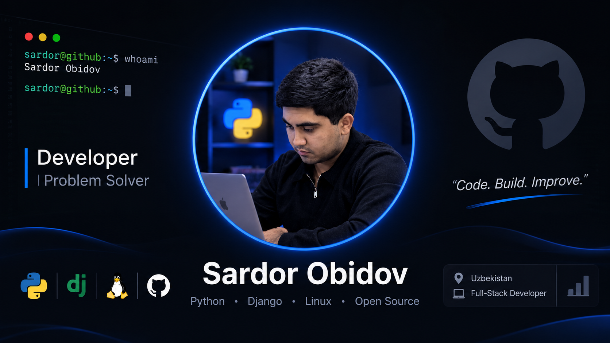

  

 

# Sardor Obidov

**Backend & Systems Engineer · Linux Infrastructure · Python**

I build backend systems, RESTful APIs, self-hosted services, and automated Linux environments with a focus on reliability, low overhead, and operational simplicity.

I believe engineering is more than writing code. It is about understanding how systems behave from the kernel and network layer up to the application, handling failures gracefully, and keeping infrastructure deterministic.

## Production Systems

### [obidovdev.uz](https://obidovdev.uz) — Personal Platform & Lab
My personal web platform and central hub for my engineering work, deployments, and technical experiments.

### Email OTP Authentication Service (`api-otp`)
A standalone authentication microservice built with Django REST Framework, handling secure email-based OTP generation, rate limiting, and stateless identity verification across applications.

### [Ob-Havo/Dev](https://github.com/obidovdev/weather) — Trilingual Weather PWA
A lightweight Progressive Web App engineered with Flask and deployed on Ubuntu Linux behind Cloudflare, Caddy reverse proxy, and Gunicorn, managed as a persistent `systemd` daemon.

### Course Attendance & Management Platform
A backend-driven web application designed around clean relational data modeling, role-based access control, and reliable state tracking.

## Local AI & Automation

### [obidovai](https://ai.obidovdev.uz) — Self-Hosted Desktop Agent
A Telegram-controlled local AI assistant powered by self-hosted Ollama models (`qwen3`, `qwen2.5`). 

Built with persistent conversational memory and OS-level execution capabilities, bridging remote messaging interfaces with local Linux automation without relying on external cloud APIs.

## Tech Stack

**Languages**
- Python, SQL, Bash

**Backend Engineering**
- Django, Django REST Framework, Flask
- REST APIs, OTP Authentication, Telegram Bot API

**Infrastructure & Operations**
- Linux (Ubuntu), `systemd`, Gunicorn
- Caddy, Cloudflare DNS & Edge Routing
- Git, `uv`, SSH, Linux Networking & Kernel Troubleshooting

**Local AI & Automation**
- Ollama (Self-hosted LLMs)
- Desktop & System Task Automation

## Engineering Focus

- Designing clean, maintainable backend architectures
- Self-hosting web services with automated process supervision (`systemd` & Caddy)
- Building privacy-first local AI tools and OS-level automation
- Optimizing Linux environments for continuous uptime and stability
- Applying cybersecurity fundamentals to API and server hardening

## Privacy, Access & Signal-to-Noise

Not every repository needs to be public, and not every system needs to be exposed.

In systems engineering, unthrottled exposure leads to noise, instability, and wasted cycles. A reliable server enforces strict firewall rules, rate limits, and clean interfaces — exposing only what is intentional and well-documented.

**I apply the same discipline to my work and time.**

Experimental scripts, internal configurations, and work-in-progress prototypes stay private until they are production-ready. What you see here is intentional, tested, and built to run reliably.

## Connect

- **Portfolio:** [obidovdev.uz](https://obidovdev.uz)
- **Telegram:** [@srdpy](https://t.me/srdpy)
- **GitHub:** [@obidovdev](https://github.com/obidovdev)

---

*Clean architecture. Intentional engineering. Reliable systems.*
